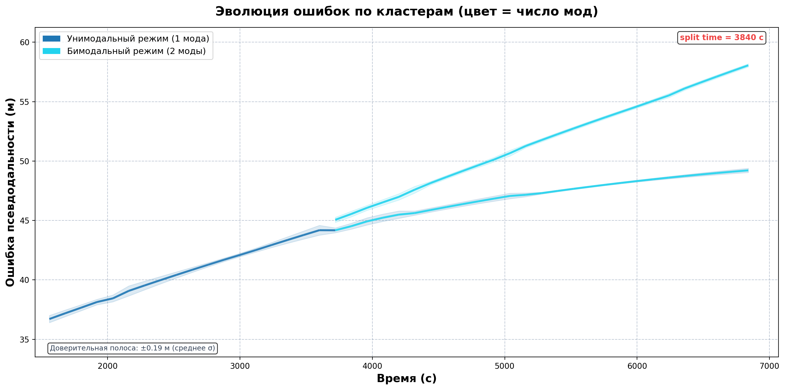
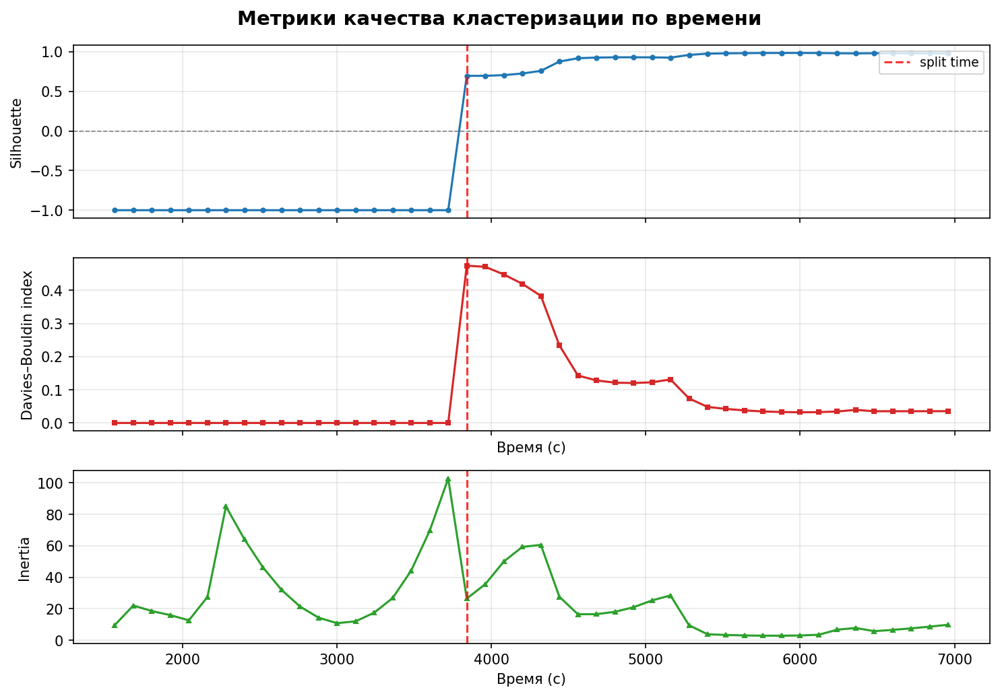

# Анализ ошибок навигационных спутниковых систем (GNSS)

Исследование распределения ошибок псевдодальностей GNSS во времени: в каждом временном окне программа ищет моды распределения ошибок и определяет момент, когда распределение из унимодального становится бимодальным (например, при появлении многолучевого/NLOS-приёма).

## Что внутри

| Часть | Технологии | Назначение |
|---|---|---|
| `src/` | C++17, Qt5 Core | Анализатор: чтение CSV, разбиение на окна, поиск мод, метрики качества |
| `plot_generator.py` | Python, pandas, Matplotlib | 2D/3D-графики плотности и графики метрик |
| `gnss_analyzer_ui.py` | PyQt5 | Графический интерфейс: выбор файла и метода, просмотр графиков |
| `tools/convert_raw_csv.py` | Python | Перевод «сырого» выгруженного файла в формат `timestamp,satellite_id,error` |
| `data/test_gnss_data.csv` | — | Пример входных данных: 21 513 измерений, 363 спутника, t = 1561…6961 с |
| `results/` | — | Пример вывода для метода EM-GMM |

## Методы поиска мод

- **EM-GMM** — смесь гауссиан, обучаемая EM-алгоритмом, с автоматическим выбором числа компонент (до 3).
- **KDE + DBSCAN** — оценка плотности ядром (KDE), затем кластеризация DBSCAN.
- **KDE + AutoKMeans** — KDE и k-means с автоподбором k по WCSS (до 3 кластеров).

Метрики для каждого окна (`metrics.csv`): **Silhouette**, **Davies–Bouldin**, **inertia**, число мод.

## Пример результата (`results/`, EM-GMM, окно 120 с)

- До t ≈ 3720 с распределение ошибок унимодальное.
- С t ≈ 3840 с обнаруживается **бимодальная структура**: Silhouette растёт с 0.70 до 0.98, Davies–Bouldin падает с 0.47 до 0.03.




## Сборка и запуск

Требования: Qt5 (`qtbase5-dev`, `qmake`), компилятор с C++17, Python 3.10+.

```bash
# Ubuntu: sudo apt install qtbase5-dev qt5-qmake build-essential
qmake && make

python3 -m venv .venv && source .venv/bin/activate
pip install -r requirements.txt
```

### CLI

Запускать из корня репозитория (анализатор вызывает `plot_generator.py` из текущей папки):

```bash
./analysis_app data/test_gnss_data.csv --method em --output-dir results
```

| Флаг | По умолчанию | Описание |
|---|---|---|
| `--method em \| kde-dbscan \| kde-kmeans` | `em` | Метод поиска мод |
| `--output-dir DIR` | `results` | Папка для CSV и графиков |
| `--bin-width SEC` | `120` | Ширина временного окна |
| `--em-max-comp N` | `3` | Максимум компонент EM-GMM |
| `--kde-bandwidth H`, `--kde-steps N` | `0.4`, `400` | Параметры KDE |
| `--cluster-eps E`, `--cluster-minpts N` | `0.4`, `3` | Параметры DBSCAN |
| `--cluster-max-k K` | `3` | Максимум кластеров AutoKMeans |
| `--filter`, `--filter-eps`, `--filter-minpts` | выкл. | Предварительная фильтрация выбросов DBSCAN |

Результат: `data_unified.csv`, `metrics.csv`, `2d_plot.*`, `3d_plot.*`, `metrics_plot.*`.

### Графический интерфейс

```bash
qmake && make            # нужен собранный analysis_app рядом со скриптом
python3 gnss_analyzer_ui.py
```

### Формат входного CSV

```
timestamp,satellite_id,error
1561.0,1,35.9695
```
